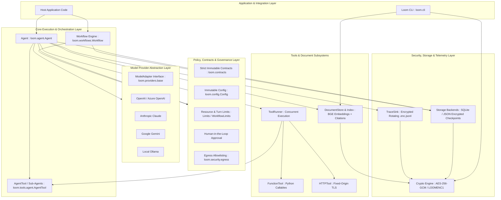

# Loom: Architecture Overview

---

## 1. Executive Architectural Summary

**Loom** ([`loom-agentic-framework`](pyproject.toml:6)) is an **embedded, deterministic, security-first Python framework** designed for building autonomous AI agents, structured multi-step workflows, tool execution pipelines, and local document retrieval (RAG).

Unlike loosely-coupled or server-hosted agent orchestration frameworks, Loom is architected as an **in-process, zero-external-daemon library** designed for enterprise environments where determinism, compliance, state recoverability, and cryptographic zero-trust boundaries are mandatory.

### Fundamental Architectural Tenets
1. **Embedded & In-Process**: Runs directly within the host application runtime (Python 3.11–3.13) without requiring external orchestrator microservices.
2. **Zero Plaintext at Rest**: All persisted state (storage checkpoints, document vector snapshots, execution traces) is sealed using authenticated AES-256-GCM encryption ([`loom.security.crypto.Crypto`](src/loom/security/crypto.py:1)).
3. **Immutable Contracts & Strict Typings**: Core entities and specifications are frozen, validated Pydantic records ([`loom.contracts`](src/loom/contracts.py:1)).
4. **Deterministic & Resilient Execution**: Built-in state machine checkpoints, budget ceilings, recursion guards, and human-in-the-loop operator reconciliation for unsafe tool crashes.
5. **Defensive Network & Egress Model**: Strict tool egress allowlisting, TLS 1.2+ certificate enforcement, and deny-by-default policies for headless execution.

---

## 2. High-Level Architecture & Layered Topography

---

## 3. Core Architectural Subsystems

### A. Agent Execution Engine ([`loom.agent.Agent`](src/loom/agent.py:1))
* **Execution Loop (`_Run.execute`)**: Manages the iterative turn lifecycle: Prompt assembly → Model turn invocation → Structured tool fan-out → Answer validation → Output packaging.
* **Dual Execution APIs**: Native asynchronous core (`arun`, `aresume`) with thread-safe synchronous facades (`run`, `resume`) that enforce clean separation from active event loops.
* **Conversation State Discipline**: Explicit state passing via [`ConversationState`](src/loom/contracts.py:1); conversations are stateless by default unless explicitly chained, preventing hidden session bleed.

### B. Workflow Orchestration ([`loom.workflows.Workflow`](src/loom/workflows.py:1))
* **Directed Graph Model**: Composed of discrete [`Step`](src/loom/workflows.py:1) nodes targeting either an `Agent` or a `Tool`.
* **Dynamic Branching**: Supports conditional transition logic via [`Branch`](src/loom/workflows.py:1) predicates and [`Case`](src/loom/workflows.py:1) evaluations.
* **Hierarchical State Ownership**: The workflow acts as the root supervisor, managing child agent execution contexts, step input/output selectors, token budgets, and step-level checkpoints.

### C. Multi-Agent Delegation ([`loom.tools.agent.AgentTool`](src/loom/tools/agent.py:1))
* **Compositional Patterns**: Allows any `Agent` to be encapsulated as a standard tool for another agent.
* **Dual Delegation Modes**:
  1. *Suspend Mode (`handoff=False`)*: Parent agent pauses, child agent executes, and its output returns as a tool observation.
  2. *Handoff Mode (`handoff=True`)*: Parent agent terminates cleanly, transferring final execution control and output to the child agent.
* **Recursion & Cycle Defense**: Enforces `max_agent_depth` and tracks active execution chains (`_agent_chain`) in [`ToolContext`](src/loom/contracts.py:1) to prevent infinite delegation loops.

### D. Tool Execution Subsystem ([`loom.tools`](src/loom/tools/base.py:1))
* **Execution Abstraction**: Base [`Tool`](src/loom/tools/base.py:1) supporting [`FunctionTool`](src/loom/tools/function.py:1) (Python callable), [`HTTPTool`](src/loom/tools/http.py:1) (fixed-origin HTTPS), and [`AgentTool`](src/loom/tools/agent.py:1).
* **Concurrent Runner ([`ToolRunner`](src/loom/tools/runner.py:1))**: Executes tool calls concurrently with per-tool timeouts, retry-after backoff calculation, and cancellation tokens.
* **Zero-Trust Tool Policies**: Tools explicitly declare `sensitive`, `retry_safe`, and `egress` network policies.

### E. Document Ingestion & RAG Pipeline ([`loom.documents`](src/loom/documents/store.py:1))
* **Local-First Processing**: Parses PDF, DOCX, and Markdown; chunks text with overlap; generates vector embeddings locally using BGE ONNX models via `fastembed`/`onnxruntime`.
* **Encrypted Snapshots**: Stores immutable vector indices as AES-256-GCM encrypted blobs.
* **Deterministic Citations**: Search results generate verifiable [`Citation`](src/loom/contracts.py:1) objects tied directly to snapshot chunk offsets.
* **Memory Protection**: Implements a shared admission ledger to bound in-memory index expansion during search queries.

### F. Cryptographic & Persistence Layer ([`loom.security`](src/loom/security/crypto.py:1) & [`loom.storage`](src/loom/storage/base.py:1))
* **Envelope Encryption**: AES-256-GCM authenticated encryption (`LOOMENC1` format) bound to canonical resource paths and cryptographic keys derived from `LOOM_ENCRYPTION_KEY`.
* **Storage Engines**:
  * [`SQLiteStorage`](src/loom/storage/sqlite.py:1): High-throughput, row-level encrypted checkpoint persistence.
  * [`JSONStorage`](src/loom/storage/json.py:1): Atomic encrypted image replacement for lightweight footprints.
* **Safe Relocation Protocol**: Offline verification ([`loom.security.relocation`](src/loom/security/relocation.py:1)) ensures encrypted assets cannot be tampered with or corrupted during disk migration.
* **Crash Recovery & Reconciliation**: Interrupted non-idempotent tool outcomes require explicit operator resolution via [`resolve_tool_outcome`](src/loom/recovery.py:1) prior to resumption.

---

## 4. Key Architectural Differentiators & Design Decisions

| Architectural Area | Standard Industry Approach | Loom Architectural Decision | Architectural Rationale |
|---|---|---|---|
| **Deployment Model** | Centralized microservice / daemon (LangGraph server, CrewAI) | Embedded library inside host process | Zero infrastructure footprint, no network hops, simplified operational surface. |
| **Data Security at Rest** | Plaintext SQLite / JSON / vector DBs | Mandatory AES-256-GCM encryption on all state files | Enterprise compliance and confidential data protection out-of-the-box. |
| **Tool Execution Safety** | Best-effort execution; arbitrary shell scripts | Explicit classification (`sensitive`, `egress`, `retry_safe`) | Prevents accidental data exfiltration and destructive headless tool calls. |
| **Recovery & Resiliency** | Blind restart or replay from start | Checkpoint-based resumption + Operator reconciliation | Guarantees non-idempotent side effects (e.g., payments, writes) are never duplicated. |
| **Configuration Scope** | Cascading environment / parent directory discovery | Strict `./loom.toml` or explicit config parameter | Eliminates configuration ambiguity and cross-tenant pollution. |

---

## 5. Details

### Core Architectural Pillars
* **Security & Isolation**: Encrypted storage, zero plaintext at rest, CA-pinned TLS 1.2+, egress allowlists.
* **Deterministic Orchestration**: State-machine workflows with discrete step transitions and token/turn budgeting.
* **Immutability**: Frozen Pydantic record contracts (`RunResult`, `AgentSpec`, `ToolSpec`).
* **Resiliency**: Durable checkpointing and supervised crash recovery.

### System Architecture & Component Model
* *Display Layered Architecture Diagram (from Section 2).*
* Explain interactions between Application Layer, Agent/Workflow Engine, Guardrails, Tool Subsystem, and Providers.

### Multi-Agent Collaboration & Workflows
* **Static vs. Dynamic Composition**:
  * `Workflow`: Statically declared DAG with branching predicates for predictable pipelines.
  * `AgentTool`: Dynamic sub-agent delegation at runtime.
* **Recursion Guard**: Stack-depth tracking and cycle detection algorithm.
* **Execution Modes**: Suspend-and-resume vs. atomic handoff.

### Zero-Trust Tooling & Egress Security
* Anatomy of a `Tool`: Specification, execution context, claim/phase/release lifecycle.
* Egress categorization (`none`, `fixed_network`, `custom`).
* Headless fail-safe: Automatic denial of unapproved sensitive operations when running non-interactively.

### Embedded RAG & Verifiable Document Retrieval
* Ingestion pipeline: PDF/DOCX/Markdown $\rightarrow$ Chunking $\rightarrow$ Local BGE ONNX Embeddings.
* Encrypted vector snapshot architecture.
* Verifiable citations tied to cryptographic chunk hashes (abstaining when facts cannot be sourced).

### Cryptography, Persistence & Resilient Recovery
* Storage backends: Encrypted `SQLiteStorage` vs. `JSONStorage`.
* Relocation & Rekeying: Safe project migration with cryptographic integrity validation (`loom crypto relocate`).
* Failure recovery: Operator reconciliation (`resolve_tool_outcome`) for uncertain non-idempotent tool states.

### Summary, Target Use Cases & Technical Roadmap
* **Target Enterprise Use Cases**:
  * High-compliance autonomous back-office agents.
  * Embedded RAG search inside sensitive local applications.
  * Deterministic multi-step business process automation.
* **Architectural Trade-offs & Boundaries**:
  * Embedded scope (not a distributed task broker).
  * Strict Python 3.11–3.13 runtime requirements.

